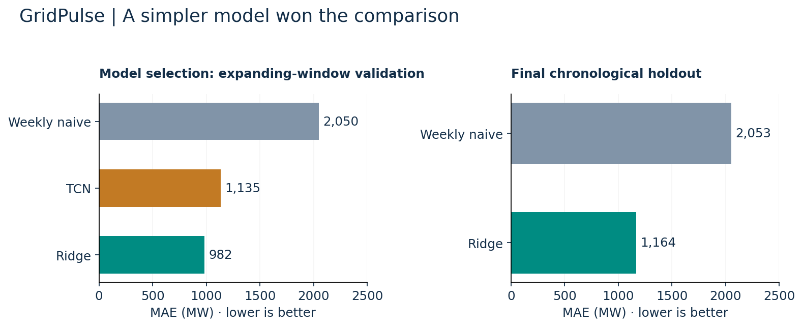

# GridPulse
### Day-ahead electricity-demand forecasting for Great Britain

**Question:** How accurately can tomorrow's 24 hourly demand values be forecast from the previous week's load and calendar information?

**Finding:** Ridge regression reduced final-test MAE by **43.3%** against a weekly seasonal-naive forecast. It also beat a temporal convolutional network on validation, so the simpler model was selected.



| Model | Mean validation MAE | Locked-holdout MAE | Locked-holdout RMSE |
|---|---:|---:|---:|
| Weekly seasonal naive | 2,050 MW | 2,053 MW | 2,781 MW |
| **Ridge** | **982 MW** | **1,164 MW** | **1,661 MW** |
| TCN | 1,135 MW | Not evaluated | Not evaluated |

[**Inspect the metrics**](reports/metrics.json) · [**Evaluation design**](docs/METHODOLOGY.md) · [**Data and run provenance**](reports/run_metadata.json)

## What this demonstrates

- A public-data ingestion pipeline with daylight-saving handling and source checksums.
- Three expanding-window validation folds, followed by a chronological holdout.
- A 168-hour input history and a direct 24-hour output, with training-only scaling.
- Error analysis for peak hours, seasons and prediction intervals.
- A Python package, command-line workflow, API demonstration and automated checks.

The benchmark uses NESO National Demand actuals from January 2015 to September 2026. The holdout contains **856 daily forecast origins and 20,544 hourly predictions**. It measures retrospective forecasting accuracy; operational savings and trading returns were not tested. The nominal 80% interval covered 75% of holdout observations.

## Run it

Python 3.10+; run from the repository root. Raw data are fetched from the public NESO portal.

```bash
python -m pip install -e ".[dev,api,deep-learning]"
python -m gridpulse.cli download --config configs/default.yaml
python -m gridpulse.cli prepare --config configs/default.yaml
python -m gridpulse.cli train --config configs/default.yaml
python -m gridpulse.cli report --config configs/default.yaml
python -m pytest -q
```

Training includes the TCN benchmark and requires PyTorch. The recorded results can be read without training. After training, `uvicorn gridpulse.api:app --host 127.0.0.1 --port 8000` starts the local demonstration API.

## Explore the repository

| Location | Purpose |
|---|---|
| [src/gridpulse](src/gridpulse/) | Ingestion, features, models, evaluation and API |
| [configs/default.yaml](configs/default.yaml) | Data range, forecast horizon and model settings |
| [reports](reports/) | Saved benchmark, EDA and run metadata |
| [tests](tests/) | Timestamp, forecast-window, metric and API checks |

The historical series contains revised actuals, rather than archived real-time data vintages. Weather forecasts are excluded. See [methodology and limitations](docs/METHODOLOGY.md).

**Author:** Fakhruddin Hakim Hussain · [Portfolio](https://github.com/Fakhruddin12)
